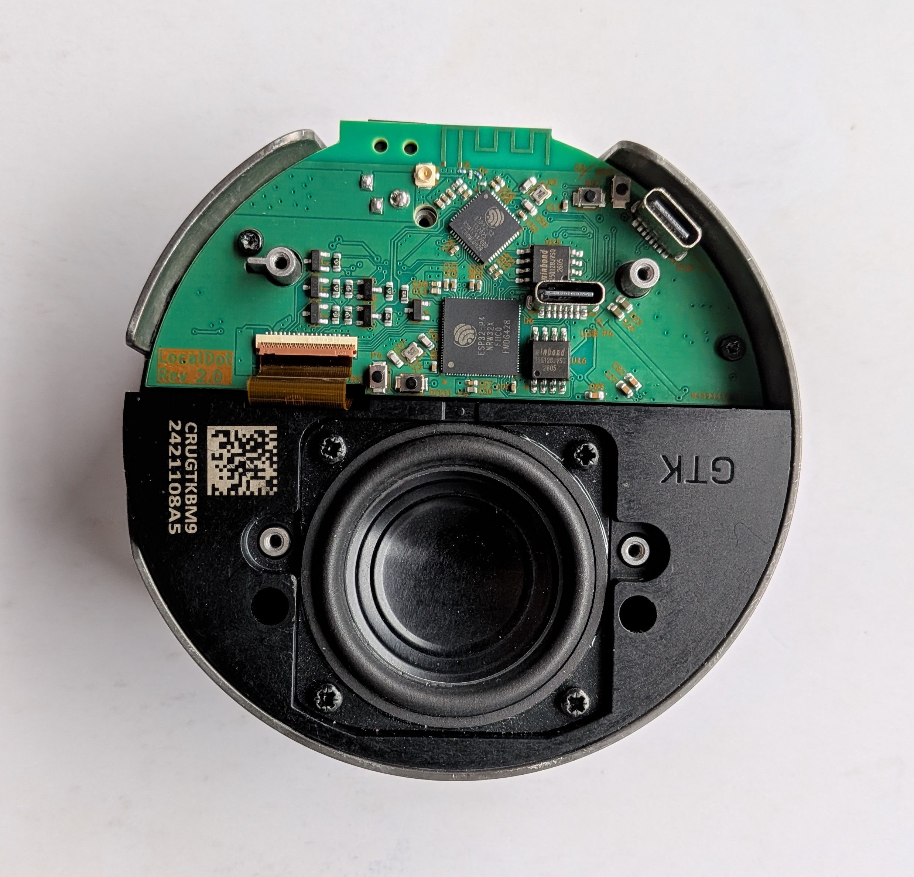
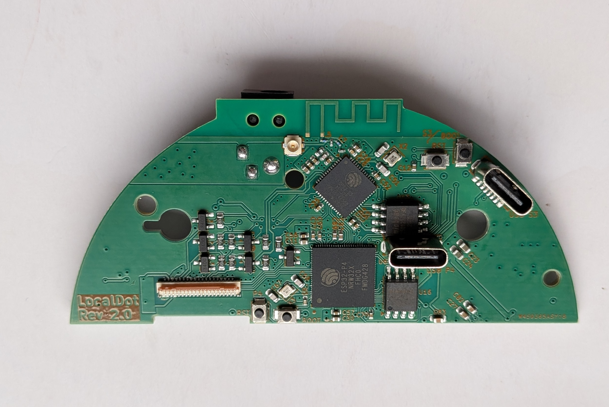
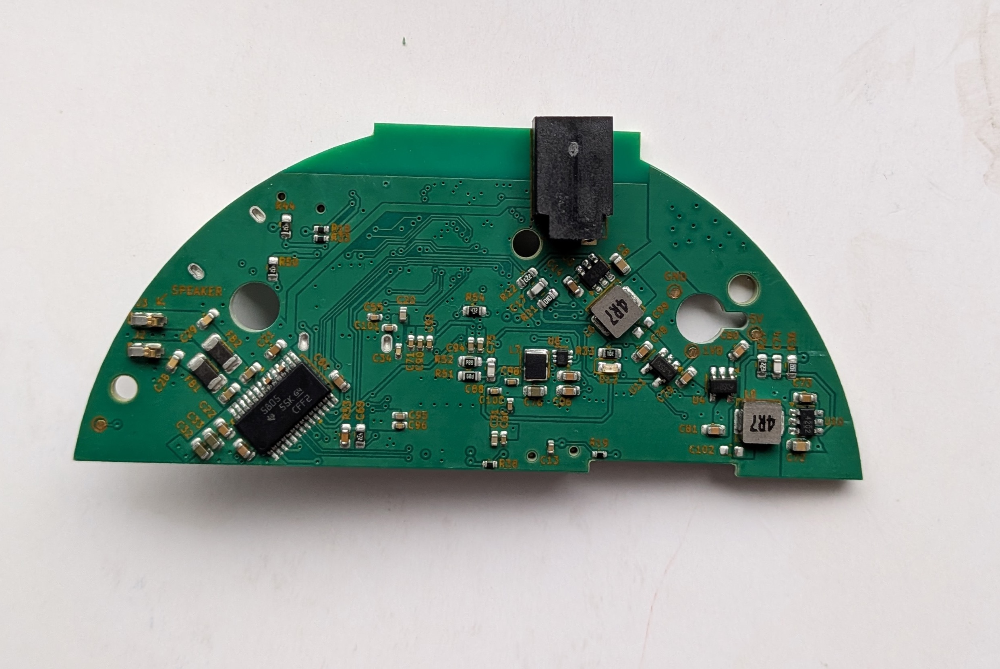
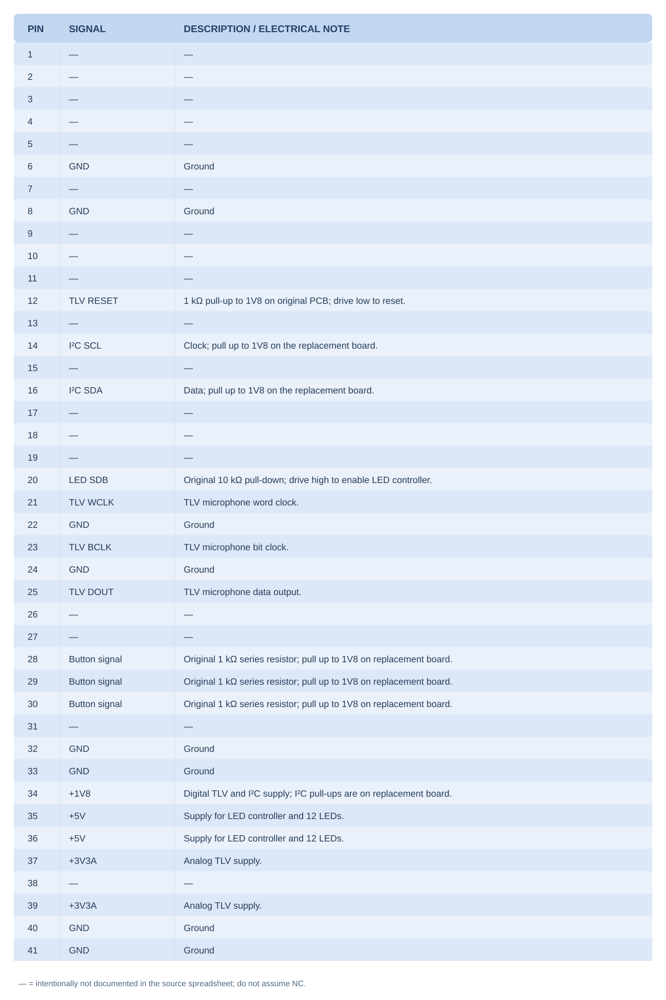

# LocalDot

LocalDot is an open-source replacement board for the 3rd-generation Echo Dot. It keeps the original enclosure, four-microphone array, speaker, buttons, and LED ring, while connecting the device to Home Assistant without requiring Amazon's servers.

*LocalDot revision 2.0 with the original speaker.*

## Why LocalDot?

An Echo Dot with working hardware can have a second life as a local voice assistant. LocalDot replaces the mainboard without modifying the enclosure, while leaving the familiar microphone array, speaker, controls, and lights in place.

## Hardware at a glance

- Designed for the 3rd-generation Echo Dot enclosure and original components
- Four microphones, with audio processing on an ESP32-P4
- ESP32-S3 for connectivity and device control
- Integration with Home Assistant for local voice-assistant features

## Revision 2.0 photos

 

*Front (left) and back (right) of the revision 2.0 board.*

## Project status and files

The revision 2.0 prototype is shown above. Hardware and firmware are still being developed, and more design files and setup instructions will be published here as they are ready.

- [LocalDot revision 2.0 schematic (PDF)](Docs/localdot-v2-schematic.pdf)
- [FPC connector pinout spreadsheet (Excel)](Docs/fpc_connector_pinout.xlsx)

## Follow the project

- [Crowd Supply pre-launch page](https://www.crowdsupply.com/aaelectronics/localdot)
- [Home Assistant Community discussion](https://community.home-assistant.io/t/re-using-an-echo-dot-3rd-gen-with-voice-assistant/1020256/17)

## FPC connector pinout

